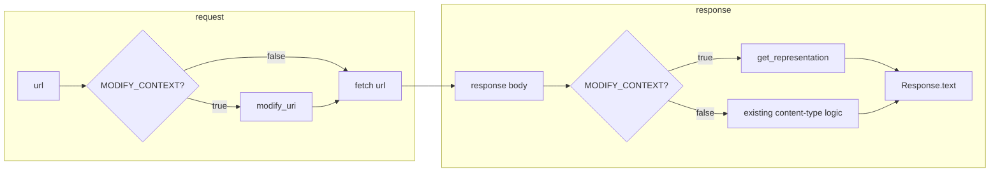
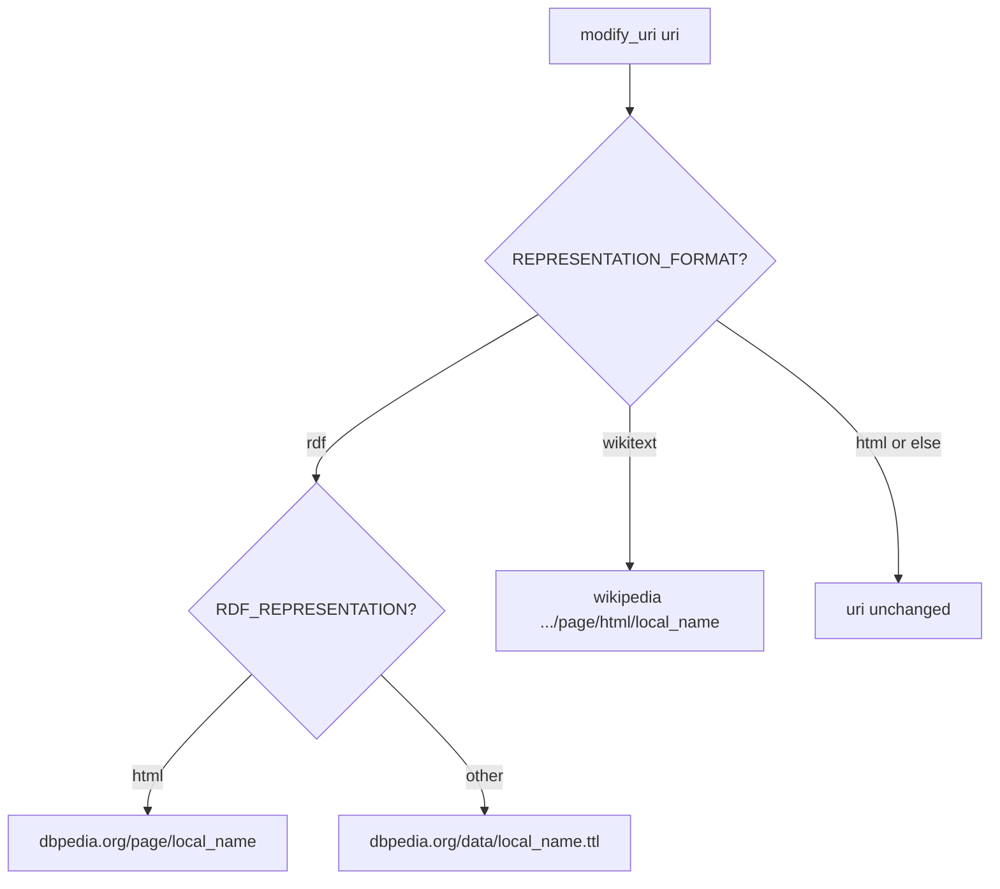
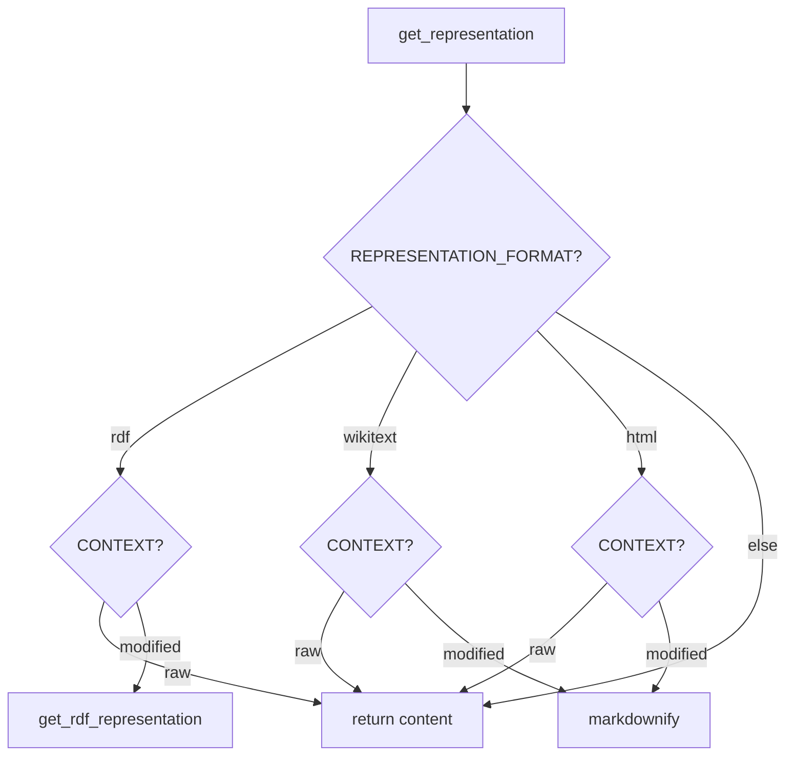
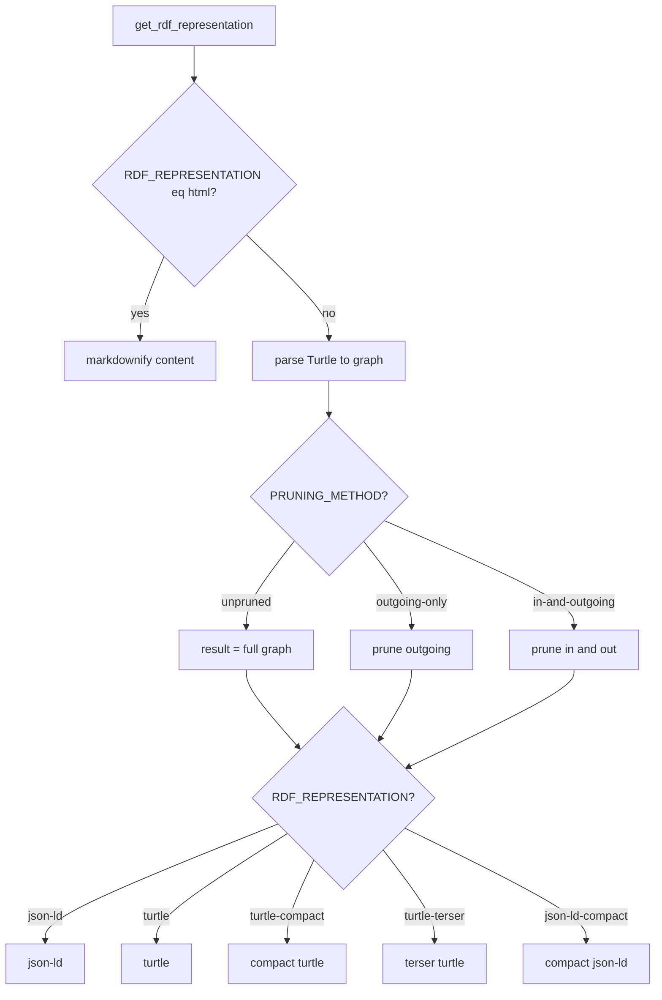
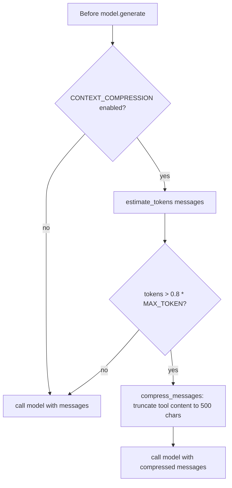

# Transformation decision tree

When which transformations are applied is determined by environment variables. This document gives the **complete** decision tree for all variables.

---

## Complete decision tree (all variables)

### Step 0: GET request (url)

```
Input: url
         │
         ▼
   MODIFY_CONTEXT?
    /          \
  false       true
    │           │
    ▼           ▼
fetch_url=url   fetch_url=modify_uri(url)
no Accept       Accept = (RDF_REPRESENTATION==html ? text/html... : text/turtle...)
    │           │
    └─────┬─────┘
          ▼
   HTTP GET fetch_url → response body
```

### Step 1: MODIFY_CONTEXT

| MODIFY_CONTEXT | Fetch URL | Accept header | Response handling |
|----------------|-----------|---------------|-------------------|
| false | `url` unchanged | default | Content-Type logic only (e.g. markdownify for text/html) |
| true | `modify_uri(url)` | From RDF_REPRESENTATION | `get_representation(body, url)` |

### Step 2: modify_uri(uri) — depends on REPRESENTATION_FORMAT and RDF_REPRESENTATION

Only used when **MODIFY_CONTEXT = true**.

```
                    modify_uri(uri)
                            │
                REPRESENTATION_FORMAT?
                 /        |        \
               rdf     wikitext   html (else)
                │          │          │
      RDF_REPRESENTATION?  │          ▼
           /        \      ▼      return uri
       "html"     other   ▼
          │          │    return https://en.wikipedia.org/api/rest_v1/page/html/{local_name}
          ▼          ▼
return https://     return http://dbpedia.org/data/{local_name}.ttl
dbpedia.org/page/{local_name}
```

| REPRESENTATION_FORMAT | RDF_REPRESENTATION | Result URL |
|-----------------------|--------------------|------------|
| rdf | html | `https://dbpedia.org/page/{local_name}` |
| rdf | json-ld, turtle, turtle-compact, turtle-terser, json-ld-compact | `http://dbpedia.org/data/{local_name}.ttl` |
| wikitext | (ignored) | `https://en.wikipedia.org/api/rest_v1/page/html/{local_name}` |
| html | (ignored) | `uri` unchanged |
| (other) | — | `uri` unchanged |

`{local_name}` = last path segment of `uri` (e.g. `Foo` from `http://dbpedia.org/resource/Foo`).

### Step 3: Response body — get_representation(content, uri)

Only used when **MODIFY_CONTEXT = true**.

```
                get_representation(content, uri)
                                │
                    REPRESENTATION_FORMAT?
                     /        |        \
                   rdf    wikitext    html   (else)
                    │         │         │       │
               CONTEXT?  CONTEXT?  CONTEXT?   ▼
                /   \     /   \     /   \   return content
              raw  mod   raw  mod  raw  mod
               │    │     │    │    │    │
               ▼    ▼     ▼    ▼    ▼    ▼
           return  get_  return md() return md()
           content rdf_  content      content
                   rep
                   (see Step 4)
```

| REPRESENTATION_FORMAT | CONTEXT | Result |
|-----------------------|---------|--------|
| rdf | raw | content as-is |
| rdf | modified | `get_rdf_representation(content, get_dbpedia_resource_uri(uri))` → see Step 4 |
| wikitext | raw | content as-is |
| wikitext | modified | `markdownify(content)` |
| html | raw | content as-is |
| html | modified | `markdownify(content)` |
| (other) | — | content as-is |

### Step 4: get_rdf_representation(content, uri)

Only when **REPRESENTATION_FORMAT = rdf** and **CONTEXT = modified**. `uri` here is the DBpedia resource URI (e.g. `http://dbpedia.org/resource/Foo`).

```
                get_rdf_representation(content, uri)
                                │
                    RDF_REPRESENTATION == "html"?
                         /              \
                       yes               no
                        │                 │
                        ▼                 ▼
                 markdownify(content)   parse content as Turtle → graph g
                 (no graph)                     │
                                        PRUNING_METHOD?
                                        /      |      \
                                unpruned  outgoing  in-and-outgoing
                                    │     -only     │
                                    ▼        ▼      ▼
                               result=g  prune_    prune_in_and_out
                                    │   outgoing      │
                                    └────────┴────────┘
                                              │
                                    RDF_REPRESENTATION?
                                    /  |  |  |  \
                              json-ld turtle turtle- turtle- json-ld-
                                    compact terser  compact
                                    │   │    │   │      │
                                    ▼   ▼    ▼   ▼      ▼
                              get_json_ld get_turtle get_compact_turtle get_terser_turtle get_compact_json_ld
```

| RDF_REPRESENTATION | PRUNING_METHOD | Outcome |
|--------------------|----------------|---------|
| html | (not used) | `markdownify(content)`; no graph. |
| json-ld | unpruned / outgoing-only / in-and-outgoing | Graph built → pruned per method → serialized as JSON-LD. |
| turtle | (same) | Graph → pruned → serialized as Turtle. |
| turtle-compact | (same) | Graph → pruned → Turtle with whitespace collapsed. |
| turtle-terser | (same) | Graph → pruned → human-readable terser format (labels + URIs). |
| json-ld-compact | (same) | Graph → pruned → JSON-LD compacted with context. |

| PRUNING_METHOD | Effect on graph |
|----------------|-----------------|
| unpruned | Use full graph. |
| outgoing-only | Keep triples where subject is target URI (and predicate allowed). |
| in-and-outgoing | Keep triples where subject or object is target URI, predicate in allowed set, URIs from dbpedia/wikipedia. |

### Step 5: Context compression (before each model call)

Applied in the **model wrapper** when the agent is about to call the LLM.

```
                    Before model.generate(messages)
                                │
                    CONTEXT_COMPRESSION enabled?
                         /              \
                       no               yes
                        │                 │
                        ▼                 ▼
                 call model(messages)   estimate_tokens(messages) = len(str(messages).split())*3
                                                │
                                    estimated_tokens > 0.8 * MAX_TOKEN_FOR_MODEL?
                                         /              \
                                       no               yes
                                        │                 │
                                        ▼                 ▼
                                 call model(messages)   messages = compress_messages(messages)
                                                               │
                                                       truncate tool message content to 500 chars + " ..."
                                                       (all but last message; non-tool unchanged)
                                                               │
                                                               ▼
                                                       call model(messages)
```

| CONTEXT_COMPRESSION | MAX_TOKEN_FOR_MODEL | Condition | Action |
|---------------------|---------------------|-----------|--------|
| false / unset | — | — | No compression. |
| true / True | default 120000 | estimated_tokens ≤ 96000 (0.8×120000) | No compression. |
| true / True | e.g. 120000 | estimated_tokens > 96000 | Compress: tool messages (except last) → content truncated to 500 chars + " ...". |

---

## 1. Fetch: URL and Accept header

- **MODIFY_CONTEXT** false: use the given `url` as-is for the request; no custom Accept.
- **MODIFY_CONTEXT** true: set `fetch_url = modify_uri(url)` and set the **Accept** header from `get_accept_header_when_modify_context()` (HTML vs RDF based on RDF_REPRESENTATION).

**modify_uri(uri)** depends on **REPRESENTATION_FORMAT** (and for rdf, **RDF_REPRESENTATION**):

- **rdf** + RDF_REPRESENTATION=html → `https://dbpedia.org/page/{local_name}`
- **rdf** + other → `http://dbpedia.org/data/{local_name}.ttl`
- **wikitext** → `https://en.wikipedia.org/api/rest_v1/page/html/{local_name}`
- **html** or else → `uri` unchanged

## 2. Response: raw vs modified

- **MODIFY_CONTEXT** false: use existing content-type logic (e.g. markdownify only for text/html).
- **MODIFY_CONTEXT** true: `text = get_representation(response.text, url)` (original `url` is passed for get_dbpedia_resource_uri in the RDF path).

**get_representation(content, uri)** branches on **REPRESENTATION_FORMAT** and **CONTEXT**:

- **rdf** + raw → return content as-is.
- **rdf** + modified → `get_rdf_representation(content, get_dbpedia_resource_uri(uri))`.
- **wikitext** or **html** + modified → `markdownify(content)`.
- **wikitext** or **html** + raw → return content as-is.
- Else → return content as-is.

## 3. RDF path: get_rdf_representation

Only when REPRESENTATION_FORMAT=rdf and CONTEXT=modified.

- If **RDF_REPRESENTATION** = **html**: return `markdownify(content)` (no graph parsing).
- Else: parse content as Turtle into a graph, then:
  - **PRUNING_METHOD**: unpruned (full graph), outgoing-only, or in-and-outgoing.
  - **RDF_REPRESENTATION**: json-ld, turtle, turtle-compact, turtle-terser, json-ld-compact → serialize the (possibly pruned) graph accordingly.

## 4. Context compression

When **CONTEXT_COMPRESSION** is enabled (e.g. "true", "True") and estimated tokens > 0.8 × **MAX_TOKEN_FOR_MODEL** (default 120000), the model wrapper compresses messages before calling the inner model: all **tool** messages (except the last) have their content truncated to 500 characters + " ..."; the last message and non-tool messages are unchanged.

---

## Mermaid diagrams

### High-level (request + response)



### modify_uri (REPRESENTATION_FORMAT + RDF_REPRESENTATION)



### get_representation (REPRESENTATION_FORMAT + CONTEXT)



### get_rdf_representation (RDF_REPRESENTATION + PRUNING_METHOD)



### Context compression (CONTEXT_COMPRESSION + MAX_TOKEN_FOR_MODEL)



---

## Env reference

| Variable | Allowed / default | Effect |
|----------|-------------------|--------|
| MODIFY_CONTEXT | true, false | Enable URI rewrite and response transformation |
| REPRESENTATION_FORMAT | rdf, wikitext, html (default wikitext) | Source type and modify_uri target |
| CONTEXT | raw, modified (default modified) | Whether to transform body |
| RDF_REPRESENTATION | html, json-ld, turtle, turtle-compact, turtle-terser, json-ld-compact (default html) | RDF serialization or HTML→markdown |
| PRUNING_METHOD | unpruned, outgoing-only, in-and-outgoing (default unpruned) | Graph pruning when RDF path is used |
| CONTEXT_COMPRESSION | true, True, false, etc. | Enable message compression when over threshold |
| MAX_TOKEN_FOR_MODEL | integer (default 120000) | Token limit for compression threshold (0.8 × this value) |
